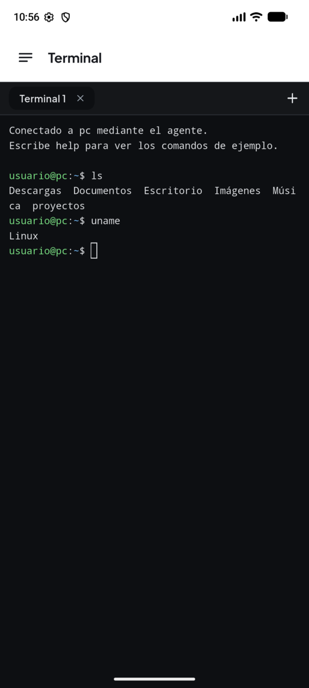
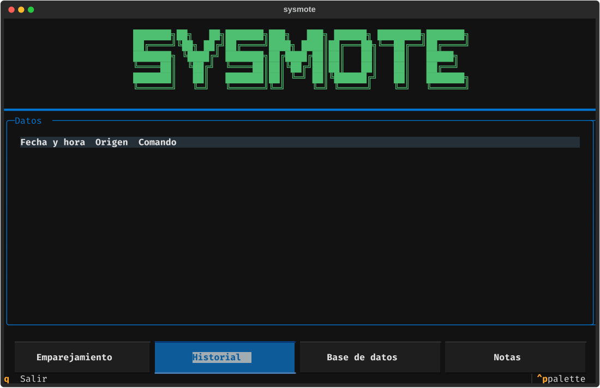
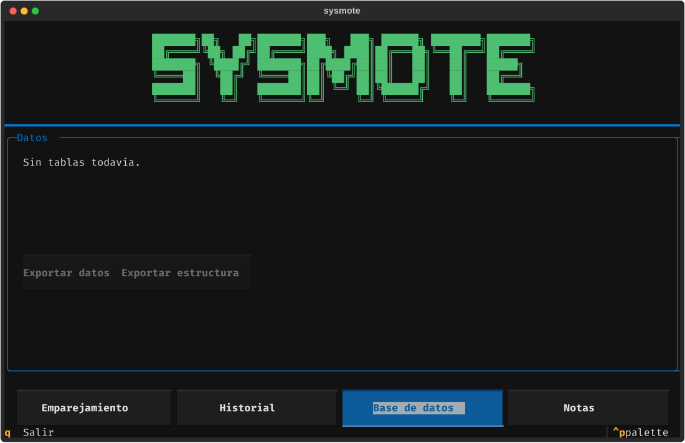
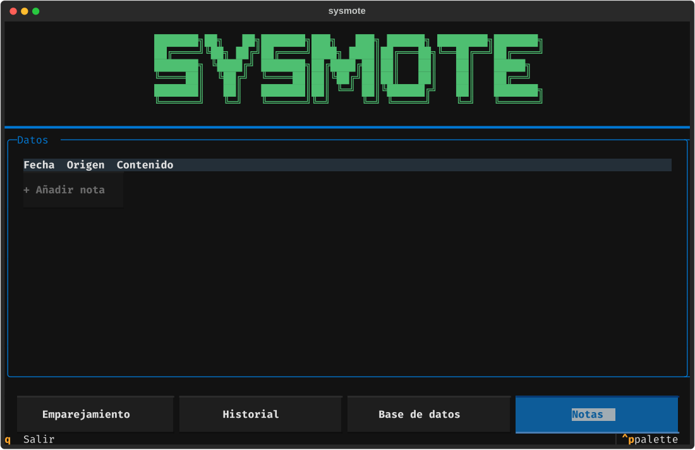

# Sysmote

**English** | [Español](README.md)

[](LICENSE)


**Manage your Linux PC from your phone, wherever you are, without opening router ports or setting up a VPN.**

> [!WARNING]
> **Work in progress: it has not been audited or tested on a physical phone yet.** There is now a login (Argon2 passwords and token sessions) and connections are encrypted: HTTPS with the certificate fingerprint pinned on the local network, and iroh's own encryption from outside. It is still a beta: use it for testing only. The agent listens on the whole local network (`0.0.0.0:8443`); without a session only `/estado`, registration and login respond.

Sysmote has two parts that are developed together:

- **An Android app** (Flutter) that is the client: it shows the PC's status and sends it commands.
- **An agent on the PC** (Python) that does the real work: it measures the system, opens terminals, runs actions and stores the data. It includes a terminal interface (`sysmote`) to configure it.

To reach the PC from outside your home network it uses [iroh](https://www.iroh.computer/), a peer-to-peer (P2P) connection library that gets through routers and firewalls without configuring them.

It is a final-year project for the Cross-Platform Application Development (DAM) vocational degree, and it is open source.

## Screenshots

The app interface is currently in Spanish.

### App

<div align="center">

<table>
  <tr>
    <td align="center"><br><sub>Home (quick actions)</sub></td>
    <td align="center"><br><sub>Live metrics</sub></td>
  </tr>
  <tr>
    <td align="center"><br><sub>Terminal</sub></td>
    <td align="center"><br><sub>Notes</sub></td>
  </tr>
</table>

</div>

The Home, Terminal and Notes screens currently show sample data: they are not connected to the agent yet. The Metrics screen does work with the real agent, after logging in.

### PC TUI (`sysmote`)

<div align="center">

<table>
  <tr>
    <td align="center"><br><sub>Pairing (with Security and Service)</sub></td>
    <td align="center"><br><sub>History</sub></td>
  </tr>
  <tr>
    <td align="center"><br><sub>Database</sub></td>
    <td align="center"><br><sub>Notes</sub></td>
  </tr>
</table>

</div>

The TUI has its complete structure. Pairing (Security and Device) already works; the remaining buttons stay disabled until their features are implemented.

## Features

| Feature | Status |
|---|---|
| Live PC metrics: CPU, temperature, RAM and disks, with charts | Available |
| Access from outside your home network through iroh (relay and direct connection) | Available |
| Login, one-time registration code, single session and unpairing | Available, not tested on a physical phone |
| App settings (units, theme, connection mode) | Available |
| Remote terminal with the user's real shell (persistent tmux sessions) | Interface done, not connected to the agent yet |
| Quick actions (saved commands, with history) | Interface done, not connected to the agent yet |
| Shared space for notes and links between phone and PC | Interface done, not connected to the agent yet |

## Current status

November 2026. The app and the agent now have a login: the account is created with a one-time code given by the TUI, and the PC's real metrics only show with a session open, both over the local network (USB, with HTTPS) and from another network through iroh. The app has been tested against the real agent over HTTPS; **it has not yet been tested on a physical phone with this version, nor the iroh path with the login**. The iroh connection was tested, before the login, at home, over mobile data and from a real restrictive network. The rest of the screens have the final interface with sample data. The agent does not have an installer yet: it is started by hand from the source code (see below).

> [!IMPORTANT]
> The APK in the `v0.1-beta` release **predates the login** and does not work with the current agent. Until a new one is published, build the app from the source code (see below).

## Roadmap

- [x] Complete app interface, with sample data
- [x] Agent with real metrics and TUI
- [x] Remote access through iroh
- [x] Login, secure pairing and encryption (TLS)
- [ ] Real remote terminal
- [ ] Agent installation as a system service
- [ ] Processes
- [ ] Quick actions
- [ ] Notifications and alert rules
- [ ] Shared notes between phone and PC
- [ ] QR scanner in the app and automatic discovery on the local network (the TUI already shows the QR)

## Known limitations

- **Unpairing on uninstall:** uninstalling the app from the phone or the agent from the PC does not unpair them automatically. Android does not notify an app when it is uninstalled, and the app cannot tell an uninstalled agent from a PC that is switched off or offline. Use the "Unpair" button (in the TUI or in the app); the session also expires by itself after 30 days without use.
- **No QR scanner:** the TUI shows the pairing QR, but the app does not scan it yet. The address, the certificate fingerprint, the iroh identifier and the registration code are typed by hand in the app.

## Installation and usage

> [!NOTE]
> **This is not the final installation.** There is no agent installer yet. This guide is for trying out the project's current state.

### Quick installation

The app is installed from an APK and the agent is started from the source code.

> [!IMPORTANT]
> The APK in the `v0.1-beta` release predates the login and does not work with the current agent. Until a new one is published in [Releases](https://github.com/Alexxio070/Alex-TFG-DAM/releases), build the app (see "Building from source"). The agent is installed as described here.

**Requirements:** a 64-bit Linux PC (glibc 2.28 or later) with Python 3.11 or later and Git, and an Android 7 or later phone (arm64). To connect them over USB, `adb` and USB debugging enabled.

**1. The app.** Once there is an APK with the login in Releases, download it and install it on your phone. Android will warn you because the APK is signed with the debug key and comes from outside the store: you need to allow installation from that source.

**2. The agent.** On the PC:

```bash
git clone https://github.com/Alexxio070/Alex-TFG-DAM.git && cd Alex-TFG-DAM/agent
python3 -m venv .venv && .venv/bin/pip install -e ".[dev]"
.venv/bin/sysmote
```

> [!IMPORTANT]
> The command `.venv/bin/sysmote` opens the TUI and **starts the agent's service**: HTTPS on port 8443, an internal HTTP only on `127.0.0.1:8444`, and the iroh tunnel. It must stay open while you use the app; when you leave the TUI the servers stop.

**3. Create the account and connect the app.**

1. In the TUI, go to **Emparejamiento → Seguridad** (Pairing → Security) and press **Configuración inicial** (Initial setup). It shows a one-time registration code that expires after 10 minutes. The certificate fingerprint and the iroh identifier appear in the text under the QR in **Dispositivo** (Device).
2. Connect the app to the agent. On the login screen, **Conexión con el PC** (Connection to the PC, or Ajustes/Settings) asks for the address, the fingerprint and the iroh identifier:
   - **Over USB (local network):** with the phone connected, run `adb reverse tcp:8443 tcp:8443`. The default address is `127.0.0.1:8443`. Type the 64-character fingerprint, comparing it with the one in the TUI.
   - **From another network, through iroh:** in Ajustes (Settings) choose the **iroh** mode and paste the identifier.
3. In the app, register with the code, a username and a password (at least 5 characters, a number and a capital letter). Then you can log in.

> [!NOTE]
> This flow is taken from the code and the documentation, and the app has been tested against the real agent over HTTPS. It has not been tested with a physical phone or over iroh with the login yet.

### Building from source

To build the app yourself, on top of the above you need [Flutter](https://docs.flutter.dev/get-started/install) (Dart `^3.13.4`), the Android SDK with NDK `29.0.14206865` and [Rust](https://rustup.rs/), because the `iroh_flutter` plugin compiles its Rust core the first time, which takes a few minutes.

```bash
cd App-movil
flutter pub get
flutter run                                          # phone connected or emulator
flutter build apk --release --target-platform android-arm64   # builds the APK
```

The agent is started and connected the same way as in the quick installation. Tests are run with `.venv/bin/pytest` (in `agent/`) and `flutter test` (in `App-movil/`).

> [!NOTE]
> If you want the `sysmote` command without a virtual environment, from the repository root:
>
> ```bash
> pipx install ./agent
> sysmote
> ```

## How it works

```
 Android phone              Internet / local network              Linux PC
 (Flutter app)   <---- iroh (encrypted QUIC) ---->   Python agent (FastAPI)
                                                      metrics, terminal, notes...
```

The app does not know which path the data takes: a single data repository chooses between a local connection (HTTP) and an iroh connection according to the Settings. On the PC, the agent exposes a local API and a small iroh tunnel that forwards the requests it receives to that API. iroh starts by using an encrypted relay and, when it can, switches to a direct connection between phone and PC.

## Documentation

The whole design is in [`doc/`](doc/) (written in Spanish):

- [`doc/documentos-generales-del-proyecto/`](doc/documentos-generales-del-proyecto/): technical report, technology needs, phase plan, decisions made and future ideas.
- [`doc/ui/`](doc/ui/): interface specification and app structure.
- [`doc/agente/`](doc/agente/): agent and TUI specification, and its tests.
- [`doc/iroh/`](doc/iroh/): what iroh is, how it is implemented, the problems found and the tests.

## Repository structure

| Folder | Contents | Stack |
|---|---|---|
| [`App-movil/`](App-movil/) | Android client | Flutter/Dart, MVVM with `provider`, `xterm.dart` |
| [`agent/`](agent/) | PC agent | Python, FastAPI, Textual, `psutil`, iroh |
| [`doc/`](doc/) | Documentation | Markdown |

## Contributing

Read the [contributing guide](CONTRIBUTING.md).

## License

Sysmote is distributed under the [GNU GPL v3.0](LICENSE) license.
