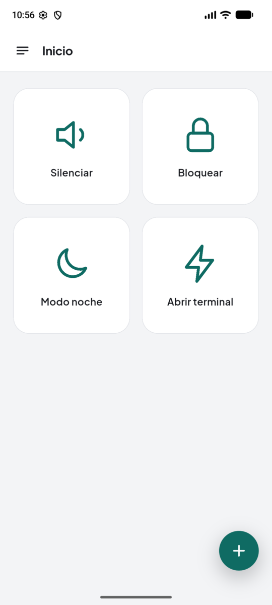
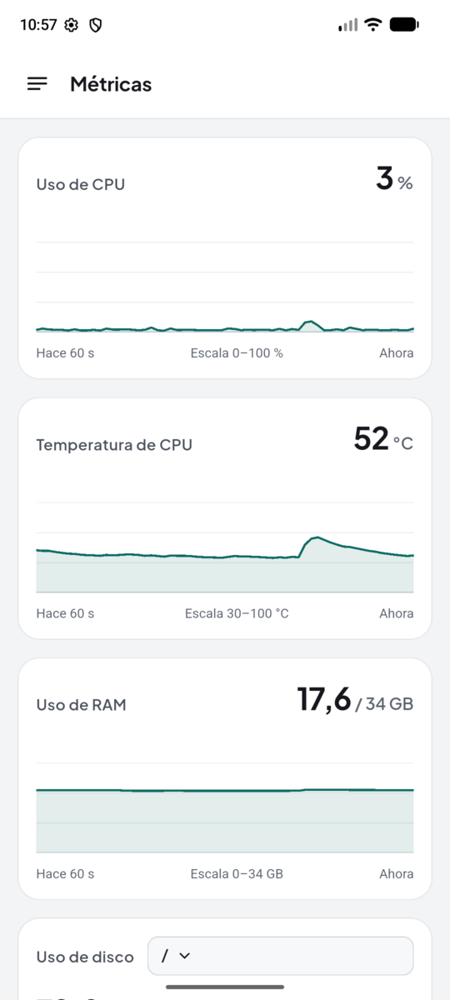
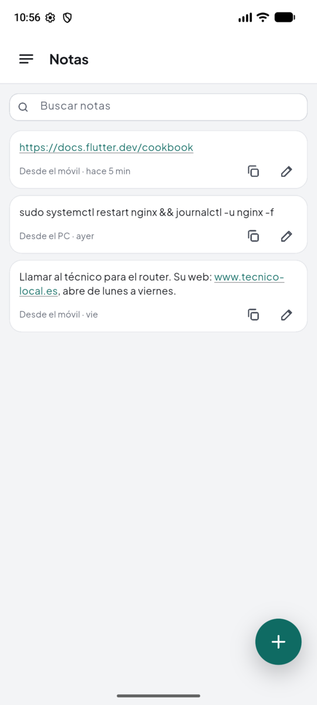
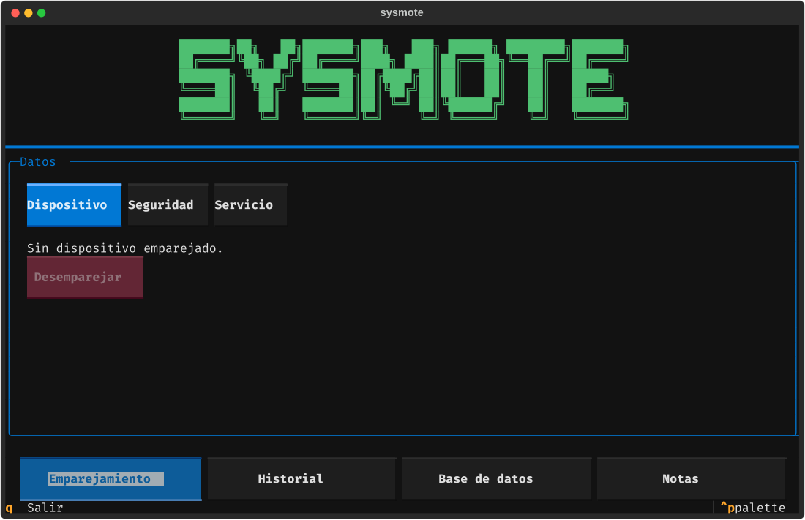

# Sysmote

**English** | [Español](README.md)

[](LICENSE)


**Manage your Linux PC from your phone, wherever you are, without opening router ports or setting up a VPN.**

> [!WARNING]
> **Work in progress: it is not safe to expose yet.** There is no login or encryption of its own yet. With iroh remote access enabled, **anyone who knows the agent's identifier can connect to it**. Today it only exposes read-only metrics, but do not share the identifier and use the agent for testing only. Do not start the agent on `0.0.0.0`: it would leave the API open to your whole local network.

Sysmote has two parts that are developed together:

- **An Android app** (Flutter) that is the client: it shows the PC's status and sends it commands.
- **An agent on the PC** (Python) that does the real work: it measures the system, opens terminals, runs actions and stores the data. It includes a terminal interface (`sysmote`) to configure it.

To reach the PC from outside your home network it uses [iroh](https://www.iroh.computer/), a peer-to-peer (P2P) connection library that gets through routers and firewalls without configuring them.

It is a final-year project for the Cross-Platform Application Development (DAM) vocational degree, and it is open source.

## Screenshots

The app interface is currently in Spanish.

### App

<div align="center">

<table>
  <tr>
    <td align="center"><br><sub>Home (quick actions)</sub></td>
    <td align="center"><br><sub>Live metrics</sub></td>
  </tr>
  <tr>
    <td align="center"><br><sub>Terminal</sub></td>
    <td align="center"><br><sub>Notes</sub></td>
  </tr>
</table>

</div>

The Home, Terminal and Notes screens currently show sample data: they are not connected to the agent yet. The Metrics screen does work with the real agent.

### PC TUI (`sysmote`)

<div align="center">

<table>
  <tr>
    <td align="center"><br><sub>Pairing (with Security and Service)</sub></td>
    <td align="center"><br><sub>History</sub></td>
  </tr>
  <tr>
    <td align="center"><br><sub>Database</sub></td>
    <td align="center"><br><sub>Notes</sub></td>
  </tr>
</table>

</div>

The TUI has its complete structure, but almost all its buttons are disabled until their features are implemented.

## Features

| Feature | Status |
|---|---|
| Live PC metrics: CPU, temperature, RAM and disks, with charts | Available |
| Access from outside your home network through iroh (relay and direct connection) | Available, no login |
| App settings (units, theme, connection mode) | Available |
| Remote terminal with the user's real shell (persistent tmux sessions) | Interface done, not connected to the agent yet |
| Quick actions (saved commands, with history) | Interface done, not connected to the agent yet |
| Shared space for notes and links between phone and PC | Interface done, not connected to the agent yet |

## Current status

November 2026. You can build the app and start the agent by hand to see the PC's real metrics on your phone, both over the local network (USB) and from another network through iroh. That connection has been tested at home, over mobile data and from a real restrictive network. The rest of the screens have the final interface with sample data. There is a test APK in the [releases](https://github.com/Alexxio070/Alex-TFG-DAM/releases). The agent does not have an installer yet: it is started by hand from the source code (see below).

## Roadmap

- [x] Complete app interface, with sample data
- [x] Agent with real metrics and TUI
- [x] Remote access through iroh
- [ ] Login, secure pairing and encryption (TLS)
- [ ] Real remote terminal
- [ ] Agent installation as a system service
- [ ] Processes
- [ ] Quick actions
- [ ] Notifications and alert rules
- [ ] Shared notes between phone and PC
- [ ] Automatic discovery on the local network and pairing by QR

## Known limitations

- **Unpairing on uninstall:** uninstalling the app from the phone or the agent from the PC does not unpair them automatically. Android does not notify an app when it is uninstalled, and the app cannot tell an uninstalled agent from a PC that is switched off or offline. Use the "Unpair" button (in the TUI or in the app); the session also expires by itself after 30 days without use. Pairing and login are not implemented yet.

## Installation and usage

> [!NOTE]
> **This is not the final installation.** There is no agent installer yet. This guide is for trying out the project's current state.

### Quick installation

The app is installed from a precompiled APK. The agent is still started from the source code.

**Requirements:** a 64-bit Linux PC (glibc 2.28 or later) with Python 3.11 or later and Git, and an Android 7 or later phone (arm64). To connect them over USB, `adb` and USB debugging enabled.

**1. The app.** Download `sysmote-v0.1-beta-arm64.apk` from [Releases](https://github.com/Alexxio070/Alex-TFG-DAM/releases) and install it on your phone. Android will warn you because the APK is signed with the debug key and comes from outside the store: you need to allow installation from that source.

**2. The agent.** On the PC:

```bash
git clone https://github.com/Alexxio070/Alex-TFG-DAM.git && cd Alex-TFG-DAM/agent
python3 -m venv .venv && .venv/bin/pip install -e ".[dev]"
.venv/bin/uvicorn sysmote.main:app --port 8443
```

> [!IMPORTANT]
> The command `.venv/bin/uvicorn sysmote.main:app --port 8443` is the one that **starts the agent's service**. It must be running while you use the app.

**3. Connect the app to the agent.**

- **Over USB (local network):** with the phone connected, run `adb reverse tcp:8443 tcp:8443`. The app looks for the agent at `127.0.0.1:8443` by default, so the metrics show up with no further setup.
- **From another network, through iroh:** start the agent with `.venv/bin/python scripts/iroh_poc.py` instead of `uvicorn`. It prints the agent's identifier: in the app's Settings, choose the **iroh** mode and paste it. Keep the security warning above in mind.

### Building from source

To build the app yourself, on top of the above you need [Flutter](https://docs.flutter.dev/get-started/install) (Dart `^3.13.4`), the Android SDK with NDK `29.0.14206865` and [Rust](https://rustup.rs/), because the `iroh_flutter` plugin compiles its Rust core the first time, which takes a few minutes.

```bash
cd App-movil
flutter pub get
flutter run                                          # phone connected or emulator
flutter build apk --release --target-platform android-arm64   # builds the APK
```

The agent is started and connected the same way as in the quick installation. Tests are run with `.venv/bin/pytest` (in `agent/`) and `flutter test` (in `App-movil/`).

> [!NOTE]
> The TUI (`sysmote`) is not useful for anything yet: its buttons are disabled. If you still want to install it, from the repository root:
>
> ```bash
> pipx install ./agent
> sysmote
> ```

## How it works

```
 Android phone              Internet / local network              Linux PC
 (Flutter app)   <---- iroh (encrypted QUIC) ---->   Python agent (FastAPI)
                                                      metrics, terminal, notes...
```

The app does not know which path the data takes: a single data repository chooses between a local connection (HTTP) and an iroh connection according to the Settings. On the PC, the agent exposes a local API and a small iroh tunnel that forwards the requests it receives to that API. iroh starts by using an encrypted relay and, when it can, switches to a direct connection between phone and PC.

## Documentation

The whole design is in [`doc/`](doc/) (written in Spanish):

- [`doc/documentos-generales-del-proyecto/`](doc/documentos-generales-del-proyecto/): technical report, technology needs, phase plan, decisions made and future ideas.
- [`doc/ui/`](doc/ui/): interface specification and app structure.
- [`doc/agente/`](doc/agente/): agent and TUI specification, and its tests.
- [`doc/iroh/`](doc/iroh/): what iroh is, how it is implemented, the problems found and the tests.

## Repository structure

| Folder | Contents | Stack |
|---|---|---|
| [`App-movil/`](App-movil/) | Android client | Flutter/Dart, MVVM with `provider`, `xterm.dart` |
| [`agent/`](agent/) | PC agent | Python, FastAPI, Textual, `psutil`, iroh |
| [`doc/`](doc/) | Documentation | Markdown |

## Contributing

Read the [contributing guide](CONTRIBUTING.md).

## License

Sysmote is distributed under the [GNU GPL v3.0](LICENSE) license.
