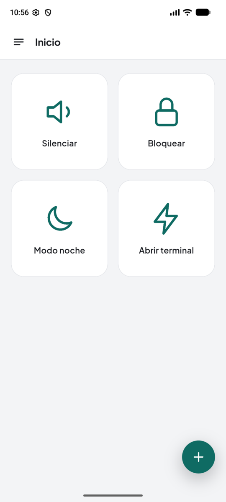
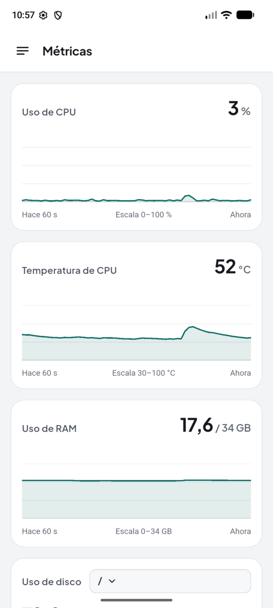
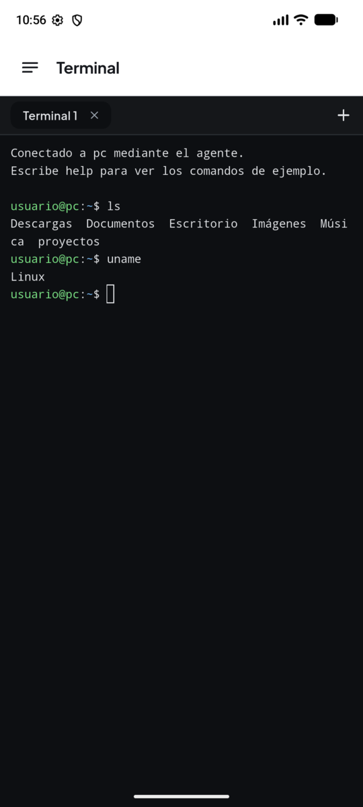
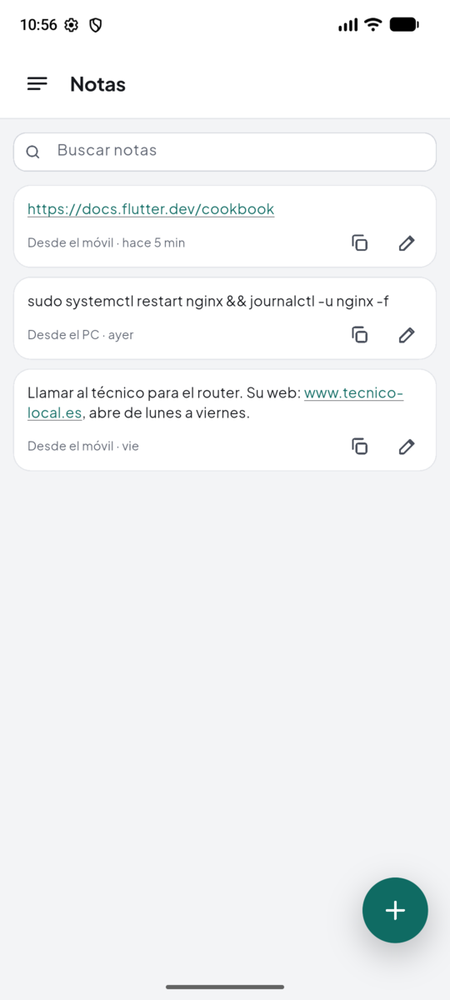
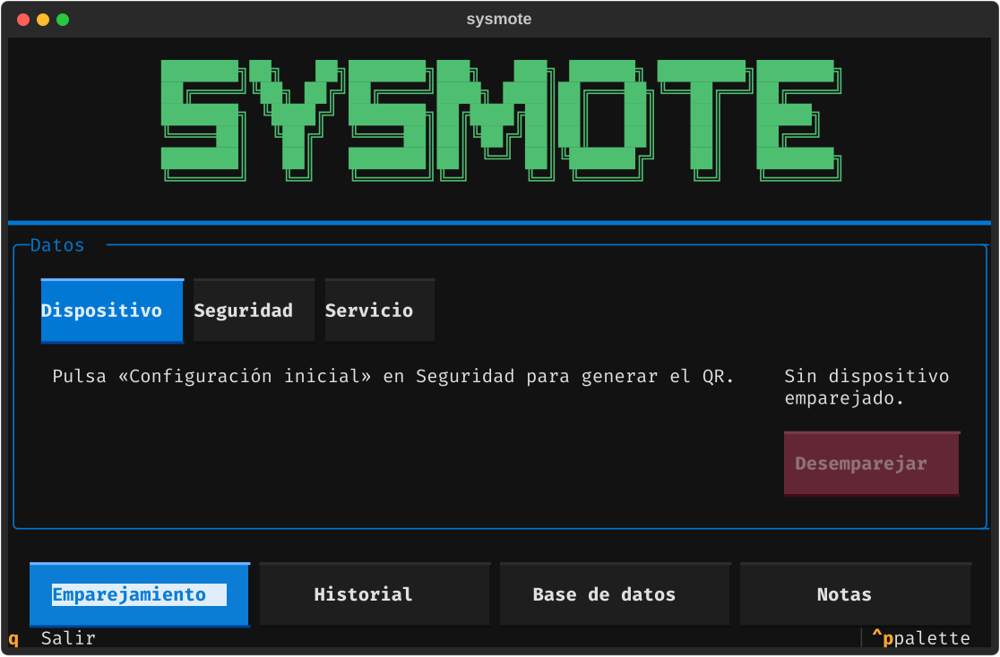
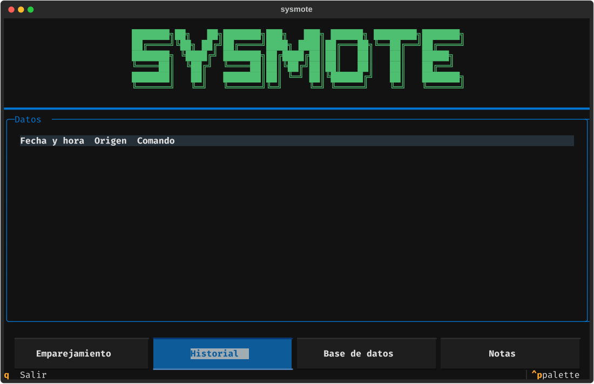
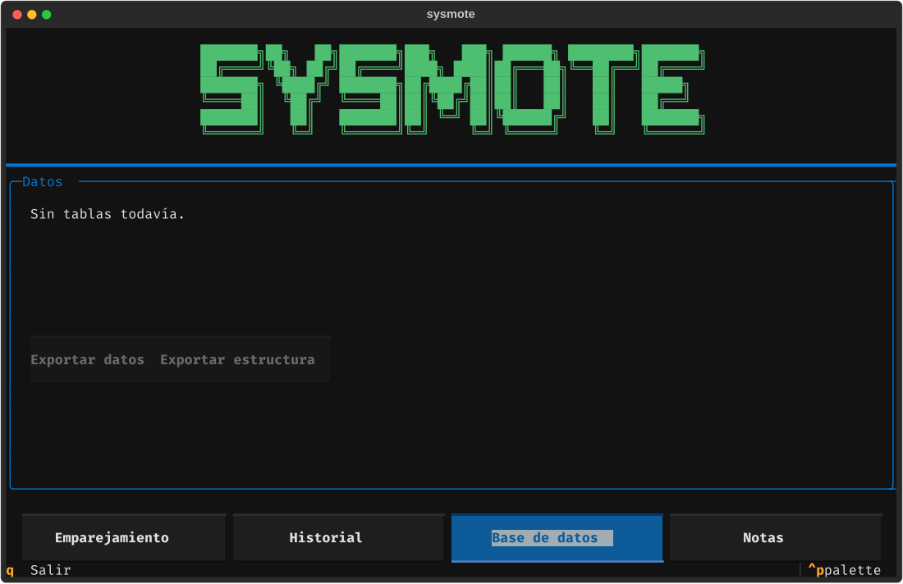
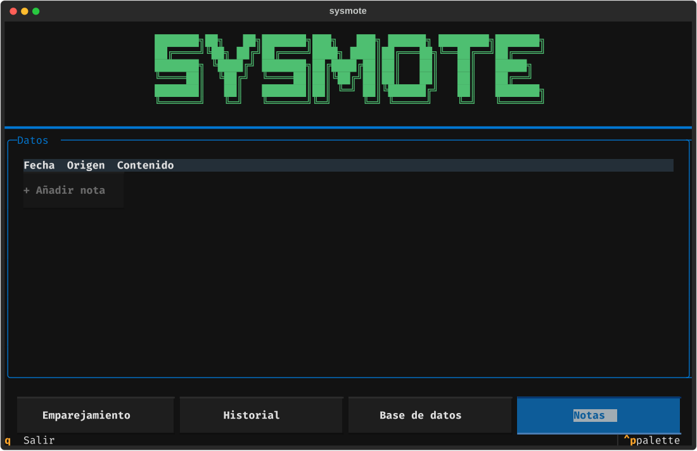

# Sysmote

[English](README.en.md) | **Español**

[](LICENSE)


**Administra tu PC Linux desde el móvil, estés donde estés, sin abrir puertos en el router ni montar una VPN.**

> [!WARNING]
> **Proyecto en desarrollo: todavía no se ha auditado y solo se ha probado en un móvil físico (Xiaomi Redmi 13C, Android 15).** Ya hay login (contraseña con Argon2 y sesiones con token) y las conexiones van cifradas: por HTTPS con la huella del certificado fijada en red local, y por el cifrado de iroh desde fuera. Aun así es una beta: úsala solo para probar. El agente escucha en toda la red local (`0.0.0.0:8443`); sin sesión solo responden `/estado`, el registro, el login y la consulta de una solicitud de login.

Sysmote tiene dos piezas que se desarrollan juntas:

- **Una app Android** (Flutter) que es el cliente: muestra el estado del PC y le manda órdenes.
- **Un agente en el PC** (Python) que hace el trabajo real: mide el sistema, abre terminales, ejecuta acciones y guarda los datos. Incluye una interfaz de terminal (`sysmote`) para configurarlo.

Para llegar al PC desde fuera de casa usa [iroh](https://www.iroh.computer/), una librería de conexión directa entre equipos (P2P) que atraviesa routers y cortafuegos sin configurarlos.

Es un proyecto de fin de grado de Desarrollo de Aplicaciones Multiplataforma (DAM), de código abierto.

## Capturas

### App

<div align="center">

<table>
  <tr>
    <td align="center"><br><sub>Inicio (acciones rápidas)</sub></td>
    <td align="center"><br><sub>Métricas en vivo</sub></td>
  </tr>
  <tr>
    <td align="center"><br><sub>Terminal</sub></td>
    <td align="center"><br><sub>Notas</sub></td>
  </tr>
</table>

</div>

Las pantallas de Inicio, Terminal y Notas muestran hoy datos de ejemplo: todavía no están conectadas al agente. La de Métricas sí funciona con el agente real, tras iniciar sesión.

### TUI del PC (`sysmote`)

<div align="center">

<table>
  <tr>
    <td align="center"><br><sub>Emparejamiento (con Seguridad y Servicio)</sub></td>
    <td align="center"><br><sub>Historial</sub></td>
  </tr>
  <tr>
    <td align="center"><br><sub>Base de datos</sub></td>
    <td align="center"><br><sub>Notas</sub></td>
  </tr>
</table>

</div>

La TUI tiene la estructura completa. Emparejamiento (Seguridad y Dispositivo) ya funciona; el resto de botones siguen deshabilitados hasta que se implementen sus funciones.

## Funciones

| Función | Estado |
|---|---|
| Métricas del PC en vivo: CPU, temperatura, RAM y discos, con gráficas | Disponible |
| Acceso desde fuera de casa por iroh (relé y conexión directa) | Disponible |
| Login, registro con código de un solo uso, sesión única y desemparejar | Disponible; probado en un móvil físico por red local y por iroh |
| Ajustes de la app (unidades, tema, modo de conexión) | Disponible |
| Terminal remota con la shell real del usuario (sesiones persistentes con tmux) | Interfaz hecha, falta conectarla al agente |
| Acciones rápidas (comandos guardados, con historial) | Interfaz hecha, falta conectarla al agente |
| Espacio compartido de notas y enlaces entre móvil y PC | Interfaz hecha, falta conectarla al agente |

## Estado actual

Noviembre de 2026. La app y el agente ya tienen login: se crea la cuenta con un código de un solo uso que da la TUI, y las métricas reales del PC solo se ven con la sesión iniciada, tanto por red local (USB, con HTTPS) como desde otra red a través de iroh. La app se ha probado contra el agente real por HTTPS; **todavía no se ha probado en un móvil físico con esta versión ni el camino por iroh con el login**. La conexión por iroh sí se probó, antes del login, en casa, con datos móviles y desde una red restrictiva real. El resto de pantallas tienen la interfaz definitiva con datos de ejemplo. El agente aún no tiene instalador: se arranca a mano desde el código fuente (ver más abajo).

> [!IMPORTANT]
> El APK de la release `v0.1-beta` es **anterior al login** y no funciona con el agente actual. Hasta que se publique uno nuevo, compila la app desde el código fuente (ver más abajo).

## Roadmap

- [x] Interfaz de la app completa, con datos de ejemplo
- [x] Agente con métricas reales y TUI
- [x] Acceso remoto por iroh
- [x] Login, emparejamiento seguro y cifrado (TLS)
- [ ] Terminal remota real
- [ ] Instalación del agente como servicio del sistema
- [ ] Procesos
- [ ] Acciones rápidas
- [ ] Notificaciones y reglas de alerta
- [ ] Notas compartidas entre móvil y PC
- [ ] Escáner de QR en la app y descubrimiento automático en red local (la TUI ya muestra el QR)

## Limitaciones conocidas

- **Desemparejar al desinstalar:** desinstalar la app del móvil o el agente del PC no desempareja automáticamente. Android no avisa a una app cuando se desinstala, y la app no puede distinguir un agente desinstalado de un PC apagado. Se desempareja con el botón «Desemparejar» (en la TUI o en la app), y la sesión caduca sola a los 30 días sin uso.
- **Bloqueo por intentos:** el límite de intentos de login es por cuenta y no por dirección, porque por iroh todas las conexiones llegan desde `127.0.0.1`. Quien alcance el agente puede bloquear el login del dueño durante unos minutos con cinco intentos fallidos. La TUI tiene un botón para levantar el bloqueo.
- **Sin escáner de QR:** la TUI muestra el QR de emparejamiento, pero la app aún no lo escanea. La dirección, la huella del certificado, el identificador de iroh y el código de registro se escriben a mano en la app.

## Instalación y uso

> [!NOTE]
> **Esta no es la instalación final.** Todavía no hay instalador del agente. Esta guía sirve para probar el estado actual del proyecto.

### Instalación rápida

La app se instala desde un APK y el agente se arranca desde el código fuente.

> [!IMPORTANT]
> El APK de la release `v0.1-beta` es anterior al login y no funciona con el agente actual. Hasta que se publique uno nuevo en [Releases](https://github.com/Alexxio070/Alex-TFG-DAM/releases), compila la app (ver «Compilar desde el código fuente»). El agente sí se instala como se indica aquí.

**Requisitos:** un PC Linux de 64 bits (glibc 2.28 o superior) con Python 3.11 o superior y Git, y un móvil Android 7 o superior (arm64). Para conectarlos por USB, `adb` y la depuración por USB activada.

**1. La app.** Cuando haya un APK con login en Releases, descárgalo e instálalo en el móvil. Android avisará porque el APK está firmado con la clave de depuración y viene de fuera de la tienda: hay que permitir la instalación desde esa fuente.

**2. El agente.** En el PC:

```bash
git clone https://github.com/Alexxio070/Alex-TFG-DAM.git && cd Alex-TFG-DAM/agent
python3 -m venv .venv && .venv/bin/pip install -e ".[dev]"
.venv/bin/sysmote
```

> [!IMPORTANT]
> El comando `.venv/bin/sysmote` abre la TUI y **levanta el servicio del agente**: HTTPS en el puerto 8443, un HTTP interno solo en `127.0.0.1:8444` y el túnel iroh. Debe estar abierto mientras uses la app; al salir de la TUI se paran los servidores.

**3. Crear la cuenta y conectar la app.**

1. En la TUI, ve a **Emparejamiento → Seguridad** y pulsa **Configuración inicial**. Muestra un código de registro de un solo uso que caduca a los 10 minutos. La huella del certificado y el identificador de iroh aparecen en el texto bajo el QR de **Dispositivo**.
2. Conecta la app con el agente. En la pantalla de login, **Conexión con el PC** (o en Ajustes) pide la dirección, la huella y el identificador de iroh:
   - **Por USB (red local):** con el móvil conectado, ejecuta `adb reverse tcp:8443 tcp:8443`. La dirección por defecto es `127.0.0.1:8443`. Escribe la huella de 64 caracteres comparándola con la de la TUI.
   - **Desde otra red, por iroh:** en Ajustes elige el modo **iroh** y pega el identificador.
3. En la app, regístrate con el código, un usuario y una contraseña (mínimo 5 caracteres, un número y una mayúscula). Después ya puedes iniciar sesión.

> [!NOTE]
> Este flujo está tomado del código y de la documentación, y la app se ha probado contra el agente real por HTTPS. El 19/11/2026 se probó con un móvil físico (Xiaomi Redmi 13C, Android 15): registro, login y métricas por red local, y login completo por iroh con datos móviles. La conexión por USB (`adb reverse`) todavía no se ha probado.

### Compilar desde el código fuente

Para compilar la app tú mismo, además de lo anterior necesitas [Flutter](https://docs.flutter.dev/get-started/install) (Dart `^3.13.4`), el Android SDK con el NDK `29.0.14206865` y [Rust](https://rustup.rs/), porque el plugin `iroh_flutter` compila su núcleo en Rust la primera vez y tarda unos minutos.

```bash
cd App-movil
flutter pub get
flutter run                                          # móvil conectado o emulador
flutter build apk --release --target-platform android-arm64   # genera el APK
```

El agente se arranca y se conecta igual que en la instalación rápida. Las pruebas se ejecutan con `.venv/bin/pytest` (en `agent/`) y `flutter test` (en `App-movil/`).

> [!NOTE]
> Si quieres el comando `sysmote` sin entorno virtual, desde la raíz del repositorio:
>
> ```bash
> pipx install ./agent
> sysmote
> ```

## Cómo funciona

```
 Móvil Android            Internet / red local              PC Linux
 (app Flutter)   <---- iroh (QUIC cifrado) ---->   agente Python (FastAPI)
                                                    métricas, terminal, notas...
```

La app no sabe por qué vía llega la información: un mismo repositorio de datos elige entre conexión local (HTTP) y conexión por iroh según los Ajustes. En el PC, el agente expone una API local y un pequeño túnel iroh que reenvía las peticiones recibidas a esa API. iroh empieza usando un relé cifrado y, cuando puede, pasa a una conexión directa entre móvil y PC.

## Documentación

Todo el diseño está en [`doc/`](doc/):

- [`doc/documentos-generales-del-proyecto/`](doc/documentos-generales-del-proyecto/): memoria técnica, necesidades tecnológicas, plan de fases, decisiones tomadas e ideas de futuro.
- [`doc/ui/`](doc/ui/): especificación de la interfaz y estructura de la app.
- [`doc/agente/`](doc/agente/): especificación del agente y de su TUI, y sus tests.
- [`doc/iroh/`](doc/iroh/): qué es iroh, cómo está implementado, los problemas encontrados y las pruebas.

## Estructura del repositorio

| Carpeta | Contenido | Stack |
|---|---|---|
| [`App-movil/`](App-movil/) | Cliente Android | Flutter/Dart, MVVM con `provider`, `xterm.dart` |
| [`agent/`](agent/) | Agente del PC | Python, FastAPI, Textual, `psutil`, iroh |
| [`doc/`](doc/) | Documentación | Markdown |

## Contribuir

Lee la [guía de contribución](CONTRIBUTING.md).

## Licencia

Sysmote se distribuye bajo la licencia [GNU GPL v3.0](LICENSE).
